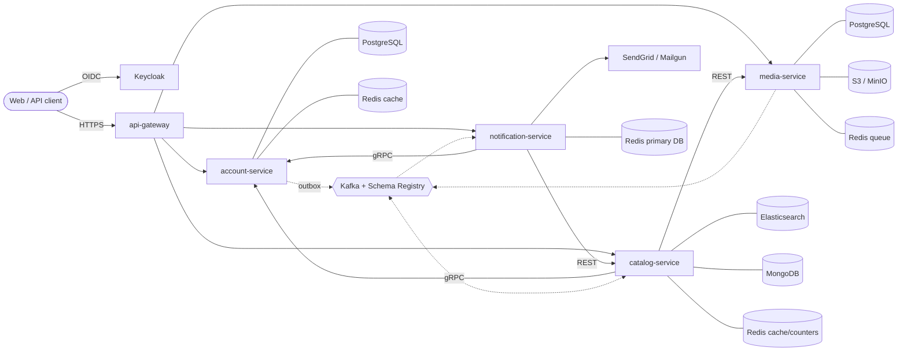
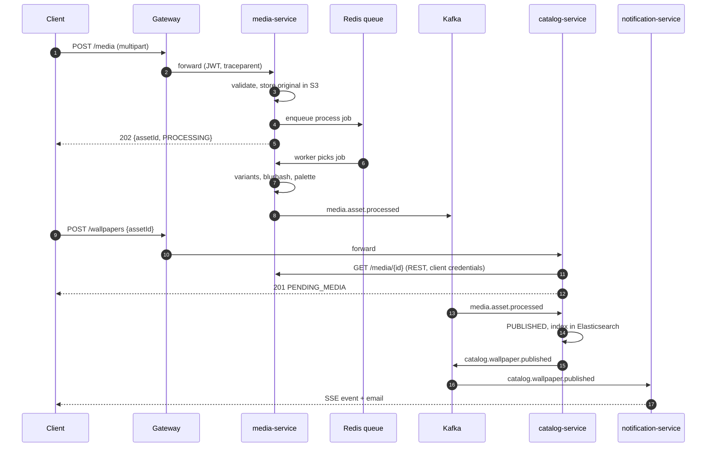

# Wallpaper Hub: Polyglot Microservice Reference Design

> **Status:** design v1.1 · **Purpose:** an educational, language-agnostic reference project. Implement the same system in many languages and frameworks to compare how each solves the same problems, and reuse it as a cheat sheet and base template for microservice applications.

The domain is a community **wallpaper-sharing platform** (think Wallhaven or Unsplash). It naturally needs avatars, banners, thumbnails and wallpapers, full-text search, email, async processing and cross-service calls. The domain is deliberately incidental: the point is the technology coverage.

**Deployables:** four domain services plus one edge service (the API gateway).

---

## Table of contents

1. [Principles](#1-principles)
2. [Architecture](#2-architecture)
3. [Services](#3-services)
4. [Key scenarios](#4-key-scenarios)
5. [Contracts](#5-contracts)
6. [Data stores](#6-data-stores)
7. [Security](#7-security)
8. [Resilience](#8-resilience)
9. [Background work](#9-background-work)
10. [Media pipeline](#10-media-pipeline)
11. [Observability](#11-observability)
12. [Internal service layout](#12-internal-service-layout-the-template)
13. [Repository layout](#13-repository-layout)
14. [Testing](#14-testing)
15. [Suggested stacks per language](#15-suggested-stacks-per-language)
16. [Requirements coverage matrix](#16-requirements-coverage-matrix)
17. [Roadmap](#17-roadmap)
18. [Decision log](#18-decision-log)

---

## 1. Principles

- **Contract-first.** OpenAPI, protobuf, Avro, GraphQL SDL and i18n keys live in `contracts/` and are the source of truth. Every implementation must satisfy them.
- **Swappable services.** Any service can be replaced by an implementation in another language. The same e2e suite validates every combination.
- **Identical structure everywhere.** Each service uses the same package/folder layout in every language, so implementations can be compared side by side.
- **Database per service.** No shared databases. Integration happens through APIs and events.
- **Zero trust inside the network.** The gateway validates tokens, but every service validates them again.
- **Everything observable.** Logs, traces and metrics flow through OTLP to Alloy and Grafana.

---

## 2. Architecture



Observability path (every service and the gateway):

```text
services --OTLP--> Alloy --> Loki        (logs)
                        --> Tempo        (traces)
                        --> Prometheus   (metrics)       all --> Grafana
```

---

## 3. Services

| Service | Persistence | Responsibilities | Protocols |
|---|---|---|---|
| **api-gateway** | none (Redis for rate-limit counters) | Single public entry point: routing, coarse JWT check, edge rate limiting, CORS, TLS termination, request/trace id, aggregated docs and health, SSE/WebSocket passthrough | HTTP in, HTTP/gRPC-web out |
| **account-service** | PostgreSQL (`users`, `outbox_event`, `audit_log`), Redis (cache) | Registration (creates the Keycloak user via admin API), profile CRUD, avatar/banner linking, token refresh/logout, **transactional outbox**, Kafka producer | REST, **gRPC server**, Kafka |
| **media-service** | PostgreSQL (`media_asset`, `media_variant`), S3/MinIO, Redis (job queue) | Upload validation, image pipeline, variants, presigned URLs, orphan cleanup | REST, Kafka producer |
| **catalog-service** | MongoDB, Elasticsearch, Redis (cache, counters, trending) | Wallpaper CRUD, search, favorites, moderation, denormalized authors | REST, **GraphQL**, **REST client** (media), **gRPC client** (account), Kafka consumer + producer |
| **notification-service** | **Redis as primary database** (inbox, preferences, dedup) | Event-driven emails, localized templates, in-app inbox, **SSE/WebSocket push**, weekly digest, task queue | REST, SSE, WebSocket, Kafka consumer, gRPC client (account), REST client (catalog), SendGrid/Mailgun |
| **Keycloak** (infra) | own DB | Identity provider, OAuth2/OIDC, service accounts | OIDC |

Runtime ports (inside each container; the compose file maps them to host ports):

| Port | Purpose |
|---|---|
| `8080` | Public HTTP API (gateway: the only service published to clients) |
| `9090` | gRPC (account only) |
| `8081` | Management: `/health/*`, optional `/metrics` |

### 3.1 API gateway

The gateway holds no business logic. Two implementation modes are supported: **off-the-shelf** (Envoy, Traefik, Kong or Spring Cloud Gateway as the default infra component) or a **hand-written thin gateway** per language as an exercise.

**Route table** (first match wins; order matters):

| Path | Upstream | Notes |
|---|---|---|
| `/api/v1/users/me/favorites` | catalog | Must be declared **before** `/api/v1/users/**` |
| `/api/v1/registrations`, `/api/v1/users/**`, `/api/v1/auth/**` | account | Registration is public |
| `/api/v1/media/**` | media | Body limit 35 MB, timeout 60 s |
| `/api/v1/wallpapers/**`, `/api/v1/collections/**` | catalog | |
| `/graphql` | catalog | |
| `/api/v1/notifications/**`, `/api/v1/notification-preferences` | notification | Includes SSE and WebSocket |
| `/docs` | gateway | Aggregated Swagger UI built from every service's OpenAPI |
| `/health` | gateway | Aggregated readiness of all upstreams |

**Policies:**

- Pre-validates the JWT (signature, `iss`, `exp`) and rejects obviously bad tokens. Fine-grained authorization stays in the services.
- **Strips** client-supplied identity headers (`X-User-*`) to prevent spoofing, generates `X-Request-Id` and the root `traceparent`, and forwards the original `Authorization` header.
- Global and per-route rate limits (Redis token bucket), per-route timeouts and body-size limits.
- Retries only for idempotent methods, with a circuit breaker per upstream.
- CORS, security headers (`HSTS`, `X-Content-Type-Options`), response compression.
- **Long-lived connections:** no response buffering and no idle timeout for SSE, and `Upgrade` support for WebSocket.
- Structured access log plus a root span for every request.

---

## 4. Key scenarios

### 4.1 Main end-to-end flow (also the e2e test)

1. `POST /registrations` creates the Keycloak user (client-credentials token) and the profile. The profile row and an **outbox event** `UserRegistered` are written in one transaction.
2. The outbox relay publishes the event. Notification-service sends a localized welcome email and writes an inbox entry.
3. The user logs in via Keycloak (authorization code + PKCE) and receives an access and refresh token.
4. `POST /media` (multipart, `purpose=WALLPAPER`) is validated, the original is stored in S3 and a job is enqueued. The response is **202**.
5. A queue worker generates variants, blurhash and palette, marks the asset `READY` and publishes `media.asset.processed` (or `media.asset.rejected`).
6. `POST /wallpapers` with `assetId`. Catalog calls media-service over REST to verify the asset exists, is owned by the caller and is `READY` or `PROCESSING`. The wallpaper is saved to Mongo as `PENDING_MEDIA`.
7. Catalog consumes `media.asset.processed`, sets the wallpaper to `PUBLISHED`, bulk-indexes it in Elasticsearch and publishes `catalog.wallpaper.published`.
8. Notification-service consumes the event, stores an inbox entry and sends an email. The user's open SSE/WebSocket connection receives the notification **live**.
9. Searching via REST or GraphQL finds the wallpaper. Authors are resolved through one gRPC batch call.



### 4.2 Avatar change and denormalization

`PUT /users/me/avatar {assetId}` updates the profile and writes a `profile-updated` outbox event in the same transaction. Catalog consumes it and updates the denormalized author snapshot across many wallpapers with a Mongo `bulkWrite`.

### 4.3 Transactional outbox (account-service)

**Problem:** writing to the DB and publishing to Kafka are two operations, so a crash between them loses or invents events (the dual-write problem).

**Solution:**

1. In the same DB transaction as the domain change, insert a row into `outbox_event`.
2. A **relay** reads unpublished rows and publishes them to Kafka. The default relay is a scheduled poller (every 500 ms, optionally woken by `LISTEN/NOTIFY`):
   ```sql
   SELECT * FROM outbox_event
   WHERE published_at IS NULL
   ORDER BY id
   LIMIT 100
   FOR UPDATE SKIP LOCKED;
   ```
3. The relay serializes the JSON payload to **Avro** at publish time (so Schema Registry compatibility is enforced), uses an idempotent producer with `acks=all`, publishes the batch, and then sets `published_at`.
4. A cleanup job deletes published rows older than 7 days.

**Guarantees and rules:**

- **At-least-once** delivery, so every consumer must be idempotent (dedupe on the `event-id` header).
- The Kafka key is the aggregate id, so events for one aggregate stay ordered within a partition.
- Run multiple relay instances safely thanks to `SKIP LOCKED`.
- Alternative (documented, not required): Debezium CDC reading the outbox table.
- **Deliberate contrast:** media-service and catalog-service publish directly after commit (best effort). Comparing the two shows the failure mode the outbox solves.
- **Metrics:** `outbox_pending`, `outbox_oldest_age_seconds`, `outbox_publish_failures_total`.
- **Tests:** stop the broker, make changes, restart it, and assert that no event is lost and none is published twice to the business logic.

### 4.4 Real-time inbox push (notification-service)

| Aspect | Design |
|---|---|
| Transports | **SSE** (primary): `GET /api/v1/notifications/stream`. **WebSocket** (alternative, same payloads): `GET /api/v1/notifications/ws` |
| Auth | Browser `EventSource` and `WebSocket` cannot set an `Authorization` header, so the client first calls `POST /api/v1/notifications/stream-tickets` (JWT-protected). It receives a **one-time ticket** (30 s TTL, stored in Redis) and connects with `?ticket=...`. Non-browser clients may use the header directly. |
| Fan-out across instances | When a notification is created, the service writes it to the inbox and publishes it on the Redis Pub/Sub channel `inbox:live:{userId}`. Every instance holding that user's connection forwards it. |
| Replay | SSE `id:` equals the notification id. On reconnect, `Last-Event-ID` replays missed items from the inbox. |
| Heartbeat | An event every 15 s keeps proxies and gateways from closing idle connections. |
| Limits | Max 3 concurrent connections per user (bulkhead), idle timeout, per-connection send buffer with drop or close policy for slow consumers. |
| Gateway | No buffering, no idle timeout, `Upgrade` passthrough. |
| Event types | `notification`, `heartbeat`, `error` |

---

## 5. Contracts

### 5.1 REST (all under `/api/v1`, reached via the gateway)

**account-service**

| Method | Path | Notes |
|---|---|---|
| POST | `/registrations` | Public, rate-limited, validated |
| GET | `/users` | ADMIN, paged, filterable |
| GET, PATCH | `/users/me` | Own profile |
| GET | `/users/{id}` | |
| DELETE | `/users/{id}` | Soft delete |
| PUT | `/users/me/avatar`, `/users/me/banner` | Body `{assetId}` |
| POST | `/auth/refresh`, `/auth/logout` | Educational token endpoints |

**media-service**

| Method | Path | Notes |
|---|---|---|
| POST | `/media` | Multipart, returns 202 |
| GET | `/media/{id}` | |
| GET | `/media` | Own assets, paged |
| GET | `/media/{id}/url` | Presigned URL |
| DELETE | `/media/{id}` | |

**catalog-service**

| Method | Path | Notes |
|---|---|---|
| GET, POST | `/wallpapers` | Paged, filterable list, create |
| GET, PUT, PATCH, DELETE | `/wallpapers/{id}` | Owner or MODERATOR for writes |
| GET | `/wallpapers/search?q=` | Elasticsearch, facets, autocomplete |
| POST, DELETE | `/wallpapers/{id}/favorite` | |
| GET | `/users/me/favorites` | |
| POST | `/wallpapers/{id}/moderation` | MODERATOR |
| CRUD | `/collections` | Optional second entity |

**notification-service**

| Method | Path | Notes |
|---|---|---|
| GET | `/notifications` | Paged inbox |
| POST | `/notifications/{id}/read` | |
| GET, PUT | `/notification-preferences` | |
| POST | `/notifications/stream-tickets` | One-time ticket for SSE/WS |
| GET | `/notifications/stream` | SSE |
| GET | `/notifications/ws` | WebSocket |
| POST | `/admin/notifications/test` | ADMIN |

### 5.2 Cross-cutting API conventions

- **Pagination:** `?page=0&size=20&sort=createdAt,desc`.
  - `size` is capped at 100.
  - `sort` fields are whitelisted per endpoint.
  - Response envelope: `{ "items": [], "page": 0, "size": 20, "totalItems": 0, "totalPages": 0 }`.
  - One catalog endpoint also offers **keyset (cursor)** pagination, and GraphQL uses Relay-style connections, so offset and cursor styles can be compared.
- **Other limits:** max search query length, max tags per wallpaper, max body size, request-level validation with field-level error codes.
- **Errors:** RFC 9457 `application/problem+json`:

  ```json
  {
    "type": "https://wallpaperhub.dev/problems/validation-failed",
    "title": "Validation failed",
    "status": 400,
    "detail": "One or more fields are invalid.",
    "instance": "/api/v1/wallpapers",
    "traceId": "4bf92f3577b34da6a3ce929d0e0e4736",
    "errors": [
      { "field": "title", "code": "NotBlank", "message": "Title must not be blank." }
    ]
  }
  ```

  `title`, `detail` and `errors[].message` are localized.
- **Idempotency:** an `Idempotency-Key` header on POST, with results stored in Redis.
- **Concurrency:** ETag and `If-Match` for optimistic locking on PUT/PATCH.
- **Localization:** `Accept-Language` selects `en`, `de` or `es` for validation messages, error text and email templates, using shared message keys from `contracts/i18n`.

### 5.3 Exception model (all services)

| Exception | HTTP | gRPC | GraphQL `extensions.code` |
|---|---|---|---|
| `ValidationException` | 400 | `INVALID_ARGUMENT` | `BAD_USER_INPUT` |
| `UnauthorizedException` | 401 | `UNAUTHENTICATED` | `UNAUTHENTICATED` |
| `ForbiddenException` | 403 | `PERMISSION_DENIED` | `FORBIDDEN` |
| `NotFoundException` | 404 | `NOT_FOUND` | `NOT_FOUND` |
| `ConflictException` | 409 | `ALREADY_EXISTS` / `ABORTED` | `CONFLICT` |
| `PayloadTooLargeException` | 413 | `RESOURCE_EXHAUSTED` | `PAYLOAD_TOO_LARGE` |
| `UnsupportedMediaException` | 415 | `INVALID_ARGUMENT` | `UNSUPPORTED_MEDIA` |
| `RateLimitedException` | 429 + `Retry-After` | `RESOURCE_EXHAUSTED` | `RATE_LIMITED` |
| `UpstreamUnavailableException` | 503 | `UNAVAILABLE` | `UPSTREAM_UNAVAILABLE` |

All derive from `AppException(code, status, args)`. One global HTTP handler, one gRPC interceptor and one GraphQL error formatter perform the mapping. Kafka consumers classify errors as **retryable** (retry topics) or **non-retryable** (DLQ).

### 5.4 gRPC (account-service)

```proto
syntax = "proto3";
package wallpaperhub.account.v1;

service AccountService {
  rpc GetUser(GetUserRequest) returns (User);
  rpc GetUsersByIds(GetUsersByIdsRequest) returns (GetUsersByIdsResponse);  // batch, feeds the DataLoader
  rpc ListUsersUpdatedSince(UpdatedSinceRequest) returns (stream User);    // server streaming demo
}

message GetUserRequest { string id = 1; }
message GetUsersByIdsRequest { repeated string ids = 1; }
message GetUsersByIdsResponse { repeated User users = 1; }
message UpdatedSinceRequest { google.protobuf.Timestamp since = 1; }

message User {
  string id = 1;
  string username = 2;
  string display_name = 3;
  string email = 4;
  string locale = 5;
  string avatar_url = 6;
}
```

### 5.5 GraphQL (catalog-service, `/graphql`)

```graphql
type Query {
  wallpaper(id: ID!): Wallpaper
  wallpapers(filter: WallpaperFilter, first: Int = 20, after: String): WallpaperConnection!
  search(q: String!, facets: [FacetKey!], first: Int = 20, after: String): SearchResult!
  me: Me!
}

type Mutation {
  favoriteWallpaper(id: ID!): Wallpaper!
  unfavoriteWallpaper(id: ID!): Wallpaper!
}

type Wallpaper {
  id: ID!
  title: String!
  tags: [String!]!
  variants: [Variant!]!
  author: Author!          # resolved through a DataLoader -> one GetUsersByIds gRPC call
  favoriteCount: Int!
}
```

Optional: a `wallpaperPublished` subscription. The DataLoader on `Wallpaper.author` is the classic **N+1** lesson.

### 5.6 Kafka topics and Avro

Subject naming is `TopicNameStrategy`, compatibility is `BACKWARD`, and the message key is the entity id. Headers carry `traceparent`, `correlation-id` and `event-id`.

| Topic | Producer | Consumers |
|---|---|---|
| `account.user.registered.v1` | account (outbox) | notification |
| `account.user.profile-updated.v1` | account (outbox) | catalog |
| `account.user.deleted.v1` | account (outbox) | catalog, media, notification |
| `media.asset.processed.v1` | media | catalog, notification |
| `media.asset.rejected.v1` | media | notification |
| `catalog.wallpaper.published.v1` | catalog | notification |
| `catalog.wallpaper.moderated.v1` | catalog | notification |

Consumers use retry topics (`<topic>.retry.<n>`) and a DLQ (`<topic>.dlq`), and dedupe on `event-id` (Redis key with TTL).

Example schema:

```json
{
  "type": "record",
  "name": "UserRegistered",
  "namespace": "dev.wallpaperhub.account.v1",
  "fields": [
    { "name": "eventId",     "type": "string" },
    { "name": "userId",      "type": "string" },
    { "name": "username",    "type": "string" },
    { "name": "email",       "type": "string" },
    { "name": "locale",      "type": "string", "default": "en" },
    { "name": "occurredAt",  "type": { "type": "long", "logicalType": "timestamp-millis" } }
  ]
}
```

**Schema evolution exercise:** add an optional `marketingConsent` field in v2 (with a default) and observe the registry enforcing compatibility, then try a breaking change and watch it get rejected.

---

## 6. Data stores

### 6.1 PostgreSQL: account-service

| Table | Key columns |
|---|---|
| `users` | `id` (uuid = Keycloak `sub`), `username`, `email`, `display_name`, `bio`, `locale`, `avatar_asset_id`, `banner_asset_id`, `status`, `deleted_at`, `created_at`, `updated_at`, `version` |
| `outbox_event` | `id` (bigserial), `event_id` (uuid), `aggregate_type`, `aggregate_id`, `event_type`, `topic`, `payload` (jsonb), `headers` (jsonb), `created_at`, `published_at`, `attempts` |
| `audit_log` | `id`, `actor_id`, `action`, `entity_type`, `entity_id`, `before` (jsonb), `after` (jsonb), `trace_id`, `created_at` |

### 6.2 PostgreSQL: media-service

| Table | Key columns |
|---|---|
| `media_asset` | `id`, `owner_id`, `purpose`, `status` (`PROCESSING`/`READY`/`REJECTED`), `original_key`, `content_type`, `size_bytes`, `width`, `height`, `sha256`, `phash`, `blurhash`, `palette` (jsonb), `reject_reason`, `created_at`, `updated_at`, `version` |
| `media_variant` | `id`, `asset_id`, `kind` (`THUMBNAIL`/`PREVIEW`/`FULL`/...), `key`, `width`, `height`, `format`, `size_bytes` |

Every table carries `created_at`, `updated_at`, `created_by` (where applicable) and `version` for optimistic locking.

### 6.3 MongoDB: catalog-service

```json
{
  "_id": "wp_01HX...",
  "title": "Misty Pines",
  "description": "Fog over a pine forest at dawn",
  "tags": ["forest", "fog", "nature"],
  "category": "NATURE",
  "status": "PUBLISHED",
  "assetId": "ast_01HX...",
  "variants": [{ "kind": "THUMBNAIL", "url": "...", "width": 320, "height": 180 }],
  "dimensions": { "width": 3840, "height": 2160 },
  "palette": ["#2b3a2f", "#8aa08c"],
  "blurhash": "LKO2?U%2Tw=w]~RBVZRi};RPxuwH",
  "author": { "id": "...", "username": "alice", "displayName": "Alice", "avatarUrl": "..." },
  "favoriteCount": 12,
  "createdAt": "2026-10-11T08:00:00Z",
  "updatedAt": "2026-10-11T08:05:00Z",
  "version": 3
}
```

Collections: `wallpapers`, `collections`, `favorites`, plus an `audit` collection for changes (app-level).

### 6.4 Elasticsearch: catalog-service

Index `wallpapers-v1` behind the alias `wallpapers`. `title` and `description` are analyzed text (with an edge-n-gram subfield for autocomplete), `tags` and `category` are keywords, `dimensions` and `createdAt` are numeric/date fields for filtering, and `favoriteCount` supports boosting. Reindexing uses a new versioned index plus an alias swap.

### 6.5 Redis key design

| Service | Key pattern | Type | Purpose |
|---|---|---|---|
| account | `cache:user:{id}` | string/hash | Cache-aside for profiles |
| gateway, all | `rl:{scope}:{key}` | string | Token-bucket rate limit state |
| all | `lock:{job}` | string | Distributed lock for scheduled jobs |
| all | `idem:{key}` | string | Idempotency results |
| media | queue keys (library-specific) | list/stream | Image-processing job queue |
| catalog | `cache:wallpaper:{id}` | string | Cache-aside, event-driven invalidation |
| catalog | `cnt:view:{id}`, `cnt:dl:{id}` | string | Counters (flushed to Mongo) |
| catalog | `hll:views:{id}` | HyperLogLog | Unique views |
| catalog | `zset:trending` | sorted set | Trending score |
| notification | `inbox:{userId}` | sorted set | Notification ids by time |
| notification | `notif:{id}` | hash | Notification body |
| notification | `prefs:{userId}` | hash | Preferences (locale, channels, digest) |
| notification | `dedup:{eventId}` | string + TTL | Consumed-event dedupe |
| notification | `inbox:live:{userId}` | pub/sub channel | Live fan-out for SSE/WS |
| notification | `stream-ticket:{ticket}` | string + 30 s TTL | One-time connection ticket |
| notification | queue keys | list/stream | Email delivery queue |

Caching rules: TTLs with jitter, **single-flight** or lock-based stampede protection, invalidation driven by Kafka events.

---

## 7. Security

**Keycloak realm `wallpaperhub`:**

| Client | Type | Purpose |
|---|---|---|
| `web-spa` | public, PKCE | End-user login |
| `account-svc`, `media-svc`, `catalog-svc`, `notification-svc` | confidential, service account | Service-to-service calls (OAuth2 **Client Credentials**) |
| `gateway` | confidential | Optional, for gateway-originated calls |

- **Roles:** realm roles `USER`, `MODERATOR`, `ADMIN`. Service accounts hold `internal`. An audience mapper adds the right `aud` per service.
- **Token validation (resource servers and gateway):** signature via cached **JWKS** with key rotation, `iss`, `aud`, `exp`/`nbf` with clock-skew tolerance, and `typ=Bearer`. Extracted claims: `sub`, `email`, `locale`, `realm_access.roles`, `scope`.
- **Authorization in three layers:**
  1. Endpoint protection: public, authenticated or internal-only.
  2. Roles and permissions, such as `wallpaper:write` and `wallpaper:moderate`, mapped from roles.
  3. Ownership checks: only the owner or a MODERATOR may edit or delete a wallpaper.
- **Client Credentials flow:** every service-to-service REST or gRPC call uses a token that is cached and refreshed shortly before expiry. It is sent as a Bearer header (REST) or metadata (gRPC).
- **Refresh tokens:** `/auth/refresh` validates token shape (`typ=Refresh`, `azp`, `exp`) and exchanges it at Keycloak. `/auth/logout` revokes it. This is educational, since normally resource servers never see refresh tokens.
- **SSE/WebSocket** use the one-time ticket described in section 4.4.

---

## 8. Resilience

**Outbound calls**

| Call | Timeout | Retry | Circuit breaker | Bulkhead | Other |
|---|---|---|---|---|---|
| gateway → any upstream | per route | idempotent methods only | per upstream | n/a | Edge rate limit |
| catalog → account (gRPC) | 300 ms deadline | 2×, backoff + jitter, only `UNAVAILABLE` | yes | n/a | **Fallback:** denormalized author snapshot |
| catalog → media (REST GET) | 1 s | 2× (idempotent) | yes | 20 concurrent | n/a |
| catalog → Elasticsearch | 2 s | 1× | yes | separate pool | **Fallback:** degraded Mongo query |
| notification → account (gRPC) | 300 ms | 2× | yes | n/a | n/a |
| notification → catalog (REST) | 1 s | 2× | yes | n/a | Digest skipped if unavailable |
| notification → SendGrid/Mailgun | 5 s | backoff, honors `Retry-After` | yes | n/a | Outbound limiter for provider quota, **failover** to the second provider |
| media → S3 | 10 s | 3× | yes | n/a | n/a |
| media image processing | per-job timeout | queue retries, then dead-letter | n/a | CPU-bound worker pool | n/a |
| account outbox relay → Kafka | producer timeouts | infinite with backoff (row stays unpublished) | n/a | n/a | Alert on outbox lag |

**Inbound protection**

| Endpoint class | Mechanism |
|---|---|
| Registration, upload, search | Redis token bucket per user/IP, `429` with `Retry-After` |
| SSE/WebSocket | Max 3 connections per user (bulkhead) |
| All | Request size limits, per-route timeouts at the gateway |

Patterns are implemented as reusable wrappers in each service's `resilience/` package, so the same policy can be compared across languages.

---

## 9. Background work

**Task queues (Redis-backed):** image processing (media) and email delivery with retry and DLQ (notification).

**Scheduling** (all with a Redis distributed lock so only one instance runs each job):

| Service | Job | Cadence |
|---|---|---|
| account | Outbox relay (poll) | 500 ms |
| account | Outbox cleanup | daily |
| account | Purge soft-deleted users | daily (30-day retention) |
| media | Orphan asset cleanup | hourly |
| catalog | Trending recompute | 5 min |
| catalog | Counter flush to Mongo (write-behind) | 1 min |
| notification | Weekly digest | weekly cron |

**Batching:**

- Elasticsearch bulk indexing
- Mongo `bulkWrite` for author denormalization
- S3 `DeleteObjects` (up to 1000 keys)
- Kafka producer batching (`linger`, batch size) and batch consumers
- Outbox relay publishes in batches of 100
- Digest aggregation per user

---

## 10. Media pipeline

| Purpose | Limits | Variants |
|---|---|---|
| `AVATAR` | ≤ 5 MB, jpeg/png/webp, ≥ 128², square crop | 512, 128, 48 (WebP) |
| `BANNER` | ≤ 8 MB, ≥ 1200×300, 3:1 crop | 1500×500, 750×250 |
| `WALLPAPER` | ≤ 30 MB, ≥ 1920×1080, jpeg/png/webp/avif | full (WebP/AVIF q80), preview 1280w, thumbnail 320w; original kept private |

**Processing steps:**

1. Sniff magic bytes (never trust extension or `Content-Type`).
2. Cap total pixel count to prevent decompression bombs.
3. Apply EXIF orientation, then **strip EXIF** for privacy.
4. Convert to sRGB.
5. Compute SHA-256 (exact duplicates) and perceptual hash (near duplicates).
6. Moderation hook (stubbed).
7. Generate blurhash and dominant palette.
8. Upload variants with `Cache-Control: immutable` under `{purpose}/{yyyy}/{mm}/{assetId}/{variant}.webp`.
9. Persist metadata, mark `READY`, publish `media.asset.processed` (or `media.asset.rejected` with a reason).

---

## 11. Observability

All services and the gateway use the OpenTelemetry SDK with standard `OTEL_*` environment variables, exporting through OTLP to **Alloy**.

| Signal | Details | Backend |
|---|---|---|
| **Logs** | Structured JSON on stdout and via the OTLP log exporter. Fields: `trace_id`, `span_id`, correlation id, user id. A utility masks PII. | Loki |
| **Traces** | HTTP, gRPC, Kafka (context in headers), SSE connection spans, and **DB spans** for Postgres, Mongo, Redis and Elasticsearch with sanitized statements. | Tempo |
| **Metrics** | Pushed via OTLP. An optional `/metrics` endpoint is exposed for contrast. | Prometheus |

**Business and platform metrics:** `uploads_total`, `image_processing_seconds`, `emails_sent_total`, `circuit_breaker_state`, `cache_hit_ratio`, queue depth, Kafka consumer lag, `outbox_pending`, `outbox_oldest_age_seconds`, `sse_connections_active`.

**Health endpoints** (management port): `/health/live`, `/health/ready` (checks dependencies), `/health/startup`. The gateway aggregates readiness at `/health`.

**Grafana** is provisioned with datasources, RED dashboards per service, and trace ↔ log ↔ metric correlation (derived fields, exemplars).

**DB audit:**

- account-service: **application-level** audit through ORM entity listeners writing `audit_log`.
- media-service: **database triggers** writing audit rows.
- catalog-service: application-level `audit` collection in Mongo.

Comparing the two approaches is part of the exercise.

---

## 12. Internal service layout (the template)

Every service uses the same layout, whatever the language:

```text
main / bootstrap        load config -> logging+telemetry -> DB/migrations -> DI wiring
                        -> HTTP(8080) + gRPC(9090) + management(8081)
                        -> consumers / workers / schedulers
                        -> graceful shutdown (drain, stop consumers, flush telemetry)
config/                 layered: defaults -> profile (local|test|prod) -> env vars -> secrets;
                        typed and validated at startup (fail fast)
api/http/               routes/controllers, filters (middleware), exception handlers
api/grpc|graphql|sse/   gRPC server + interceptors, GraphQL resolvers, SSE/WebSocket handlers
dto/                    request/response DTOs with validation annotations/rules
mapper/                 entity <-> DTO <-> event mappers
domain/                 models, domain exceptions, services (business logic)
repository/             Postgres | Mongo | Redis | Elasticsearch access
infra/                  kafka, outbox relay, s3, mail, REST/gRPC clients, token provider
security/               JWT validation, permission checks
resilience/             circuit breaker, retry, timeout, rate limiter, bulkhead wrappers
jobs/                   queue workers, schedulers
i18n/                   message bundles (en, de, es)
util/                   pagination, ids, clock, PII masking, hashing, fast JSON setup
resources/              migrations, config files, bundles
```

**Filter / middleware order:** correlation-id → request logging → locale resolution → rate limiting → authentication → idempotency → compression, CORS and security headers.

**Configuration:** 12-factor, one file per profile, overridable by env vars, secrets from files or a vault. Feature toggles (for example `outbox.relay.enabled`, `mail.provider`) are plain config.

**Migrations:** executed by a separate `migrate` command (and optionally on startup behind a flag), always forward-only and repeatable.

---

## 13. Repository layout

```text
wallpaper-hub/
├── README.md
├── contracts/
│   ├── openapi/            golden specs, one per service
│   ├── proto/              account/v1/account.proto
│   ├── avro/               *.avsc per topic value
│   ├── graphql/            catalog.graphqls
│   ├── i18n/               shared message keys + en/de/es bundles
│   └── db-schema/          canonical reference schema for parity checks
├── infra/
│   ├── docker-compose.yml  profiles: infra | observability | apps
│   ├── keycloak/           realm-export.json (clients, roles, mappers)
│   ├── alloy/              config.alloy (OTLP in; Loki, Tempo, Prometheus out)
│   ├── grafana/            provisioning/ + dashboards/
│   ├── prometheus/  loki/  tempo/
│   ├── minio-init/         bucket and policy bootstrap
│   └── schema-registry-init/
├── services/
│   ├── gateway/            {envoy-or-traefik | java-spring-gateway | go | ts | ...}
│   ├── account/            {java-spring | kotlin-ktor | go | python-fastapi | ...}
│   ├── media/              {...}
│   ├── catalog/            {...}
│   └── notification/       {...}
├── e2e/                    language-agnostic scenario suite (k6, Hurl or pytest)
└── docs/
    └── CHEATSHEET.md       per service: concept -> file path (one per implementation)
```

Each `services/<name>/<language>/` folder follows the template in section 12 and ships its own `CHEATSHEET.md` mapping concept to file (for example *"validation → `dto/CreateWallpaperRequest.*`"*).

**Continuous-integration gates:** formatter, linter and type check; unit tests; integration tests; Avro compatibility check; OpenAPI diff against `contracts/openapi`; then the e2e suite against compose.

---

## 14. Testing

| Level | Scope |
|---|---|
| **Unit** | Mappers, validators, services (mocked repositories), utilities, resilience policies, image pipeline, outbox relay logic |
| **Integration** | Testcontainers: Postgres, Mongo, Redis, Kafka + Schema Registry, Elasticsearch, MinIO, Keycloak (realm import). WireMock or in-process servers for upstream REST/gRPC. Mailpit replaces SendGrid/Mailgun; the provider port has SMTP and HTTP-API adapters. |
| **Contract** | Avro compatibility, OpenAPI diff, optional Pact for REST clients |
| **End-to-end** | Full docker-compose stack, scenario from section 4.1: register, upload, publish, search, email arrives in Mailpit, **SSE event received**. Plus an outbox failure test (broker down and up) and a rate-limit test. |

---

## 15. Suggested stacks per language

| Language | Frameworks | ORM / migrations | Lint / format / types | Fast JSON |
|---|---|---|---|---|
| Java | Spring Boot, Quarkus, Spring Cloud Gateway | JPA/Hibernate, Flyway | Checkstyle, Spotless, ErrorProne | Jackson (afterburner/blackbird) |
| Kotlin | Ktor, Spring | Exposed, Flyway | detekt, ktlint | kotlinx.serialization |
| Go | chi/gin, grpc-go | GORM or sqlc, goose | gofmt, go vet, golangci-lint | sonic / jsoniter |
| Python | FastAPI | SQLAlchemy, Alembic | ruff, black, mypy/pyright | orjson |
| TypeScript | NestJS, Fastify | Prisma/TypeORM, migrations | eslint, prettier, `tsc --strict` | fast-json-stringify |
| C# | ASP.NET Core, YARP (gateway) | EF Core migrations | dotnet format, Roslyn analyzers, nullable | System.Text.Json source-gen |
| Rust | axum, tonic | SeaORM/sqlx, sqlx-migrate | rustfmt, clippy | serde_json / simd-json |

---

## 16. Requirements coverage matrix

| Requirement | Where it is demonstrated |
|---|---|
| Application entry points | Every service: bootstrap order in section 12 |
| HTTP servers | All services and the gateway |
| Models, DTOs, mappers | `domain/`, `dto/`, `mapper/` in every service |
| Validation | DTO validation (account, catalog), file validation (media), `Idempotency-Key`, pagination limits |
| Exceptions and handlers | Section 5.3; HTTP, gRPC, GraphQL and Kafka handlers |
| Controllers: CRUD, pagination, limits | catalog `/wallpapers`, account `/users`, notification `/notifications` |
| Services, repositories | `domain/`, `repository/` in every service |
| Configuration files | Layered profiles, typed config |
| Localization | `en`/`de`/`es` for errors, validation and email templates |
| OpenAPI | Generated per service, diffed against `contracts/openapi`, aggregated in the gateway `/docs` |
| Logging | Structured JSON + OTLP, correlation ids |
| Utilities | `util/`: pagination, PII masking, hashing, JSON setup |
| Resilience (CB, retry, timeout, rate limit, bulkhead) | Section 8 matrix |
| Filters | Middleware chain (section 12), gateway policies |
| HTTP (REST) and gRPC clients | catalog → media (REST), catalog/notification → account (gRPC), notification → catalog (REST) |
| GraphQL | catalog `/graphql`, DataLoader, Relay pagination |
| Kafka + Schema Registry (Avro) | Section 5.6; all four domain services |
| Redis cache | account, catalog |
| Redis as a database | notification (inbox, preferences, dedup), catalog counters |
| PostgreSQL | account, media |
| MongoDB | catalog |
| ORM and migrations | account, media (Postgres) |
| S3, image/file validation and compression | media: section 10 |
| SMTP via SendGrid/Mailgun | notification (SMTP + API adapters, provider failover) |
| Text search (Elasticsearch) | catalog search, autocomplete, facets |
| Health checks and metrics endpoints | `/health/*` and `/metrics` on the management port |
| DB tracing and audit | DB spans; ORM-listener, trigger and Mongo audit variants |
| Logs (Loki + Alloy + Grafana) | Section 11 |
| Traces (Tempo + Alloy + Grafana) | Section 11 |
| Metrics (Prometheus + Alloy + Grafana) | Section 11 |
| Keycloak, access/refresh token validation, Client Credentials | Section 7 |
| Security (endpoint protection, roles, claims, permissions) | Section 7: three authorization layers |
| Tests (unit, integration, e2e) | Section 14 |
| Task queues | media image jobs, notification email jobs |
| Scheduling | Section 9 |
| Batching | Section 9 |
| Checkstyle, type checker, formatters, linters | Section 15, CI gates in section 13 |
| Fast JSON serialization | Per-language library in section 15; configured in `util/` |
| **Transactional outbox** | account-service, section 4.3 |
| **WebSocket / SSE** | notification-service, section 4.4 |
| **API gateway** | Section 3.1 |

---

## 17. Roadmap

| Phase | Deliverable |
|---|---|
| **0** | Infra compose, Keycloak realm, Alloy/Grafana stack, all contracts, e2e skeleton |
| **1** | **account-service** (the template service): config, HTTP, DTOs, mappers, validation, errors, i18n, Postgres + ORM + migrations, Redis cache, gRPC server, **outbox + relay**, Kafka producer, security, audit, lint tooling, full test pyramid. Finish it completely in the first language before starting others. |
| **2** | **media-service**: S3, image pipeline, queue, scheduling |
| **3** | **catalog-service**: Mongo, Elasticsearch, GraphQL, REST + gRPC clients, resilience, batching, Kafka consumers |
| **4** | **notification-service**: Redis as a database, email providers, digest, DLQ, **SSE/WebSocket push** |
| **5** | **api-gateway**: off-the-shelf first, then a hand-written version; aggregated docs and health |
| **6** | E2E suite complete, dashboards, Avro v2 evolution exercise, then port services to the next language one at a time |

---

## 18. Decision log

| # | Decision | Reason |
|---|---|---|
| 1 | Contract-first with a shared `contracts/` folder | Enables mixing languages per service and one shared e2e suite |
| 2 | Four domain services plus a gateway | The domain fits four services; the gateway is edge infrastructure |
| 3 | Outbox stores JSON, Avro-serializes at publish time | Keeps Schema Registry compatibility enforced and the table readable |
| 4 | Outbox only in account-service | Other services publish directly, which gives a deliberate contrast |
| 5 | SSE as the primary push transport, WebSocket as an alternative | SSE is simpler and fits one-way notifications; WebSocket shown for comparison |
| 6 | One-time ticket for SSE/WebSocket auth | Browsers cannot set `Authorization` on `EventSource`/`WebSocket` |
| 7 | Redis as the primary DB in notification-service | Demonstrates Redis beyond caching |
| 8 | Both OTLP metrics and optional `/metrics` | Shows push and pull side by side |
| 9 | Gateway validates tokens, services validate again | Zero trust inside the network |
